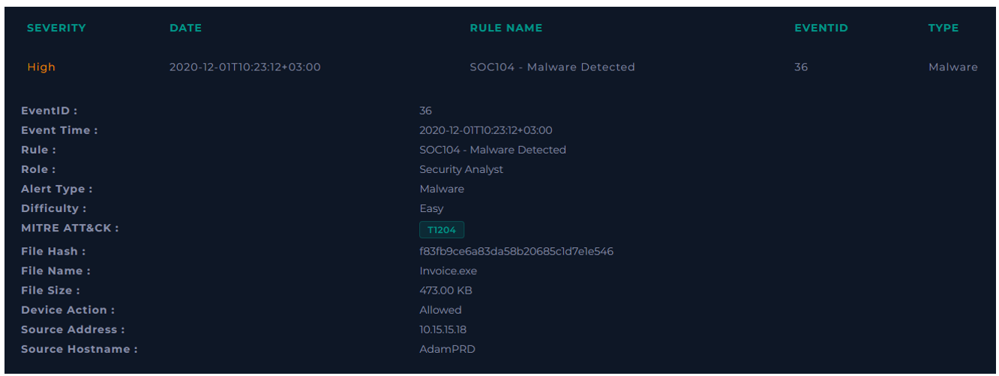
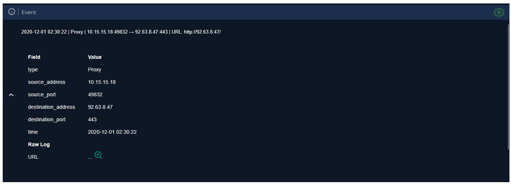
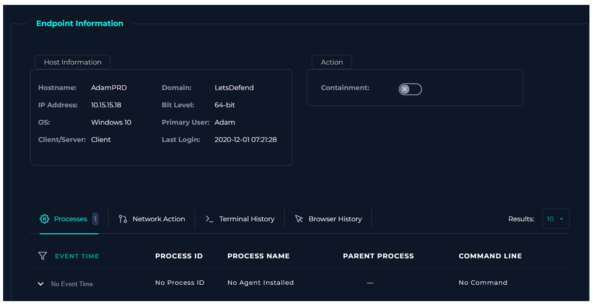
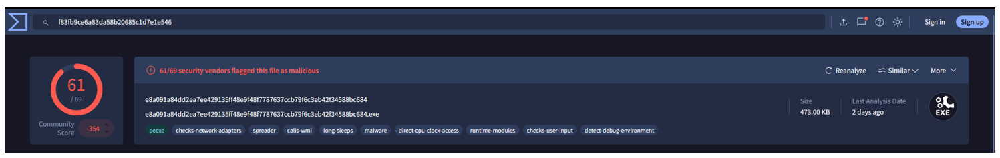
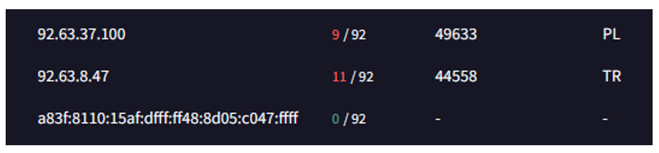
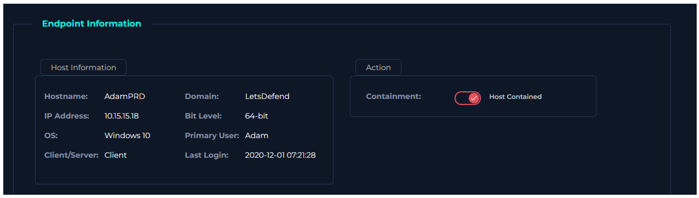

  

---

# ¿Verificar si el malware está en cuarentena/limpiado?

**Gestión de Registros (Log Management):** Entro a una URL maliciosa.

**Seguridad de Endpoints (Endpoint Security):** No hay ningún rastro de actividad.

**¿Malware en cuarentena/limpiado?** No.

# Análisis de Malware

Buscamos el hash en VirusTotal, encontramos que es malicioso.

Tal como vimos anteriormente, la IP a la que se comunicó el host tiene relación con este malware (IP: 92.63.8.47).

Procedemos a aislar el host.

**VEREDICTO:** `VERDADERO POSITIVO`
