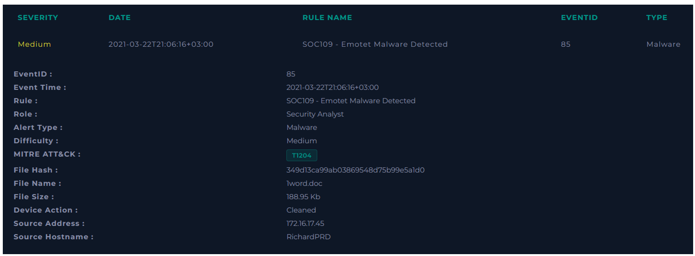
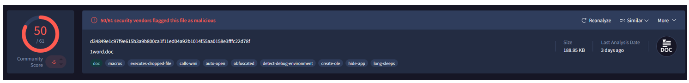
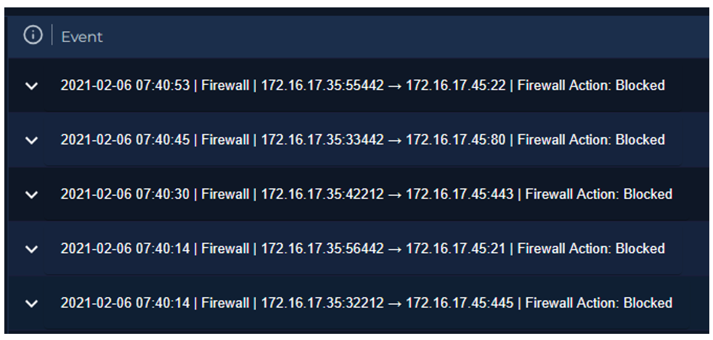

  

---

# Obtenemos información del caso

**File Hash:** 349d13ca99ab03869548d75b99e5a1d0

**File Name:** 1word.doc

**Device Action:** Cleaned

**Source Address:** 172.16.17.45

**Source Hostname:** RichardPRD

Al buscar tanto en el Endpoint Security como en el Log Management 

# Análisis de malware

Según VirusTotal, este es un malware.

El host solo interactuó con la red interna de la empresa.

**VEREDICTO:** `VERDADERO POSITIVO`
