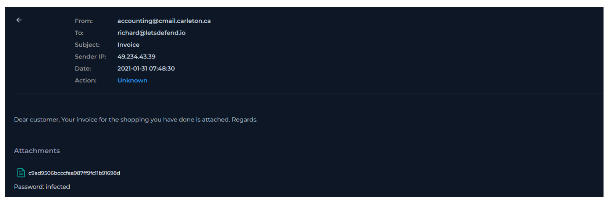
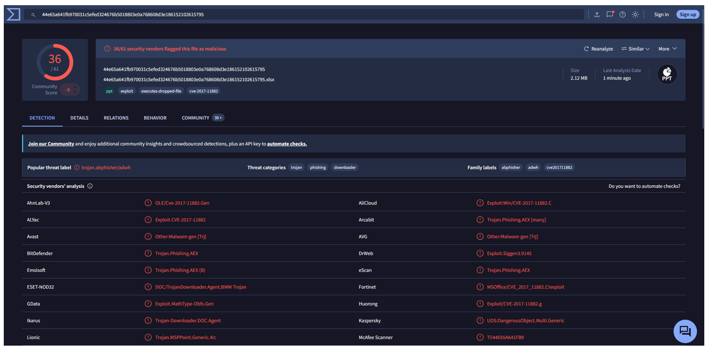
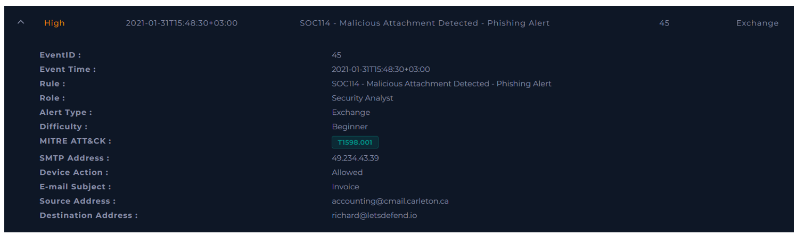
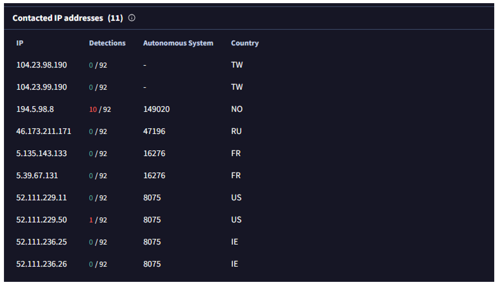
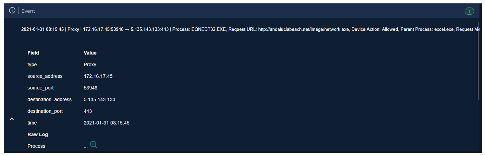
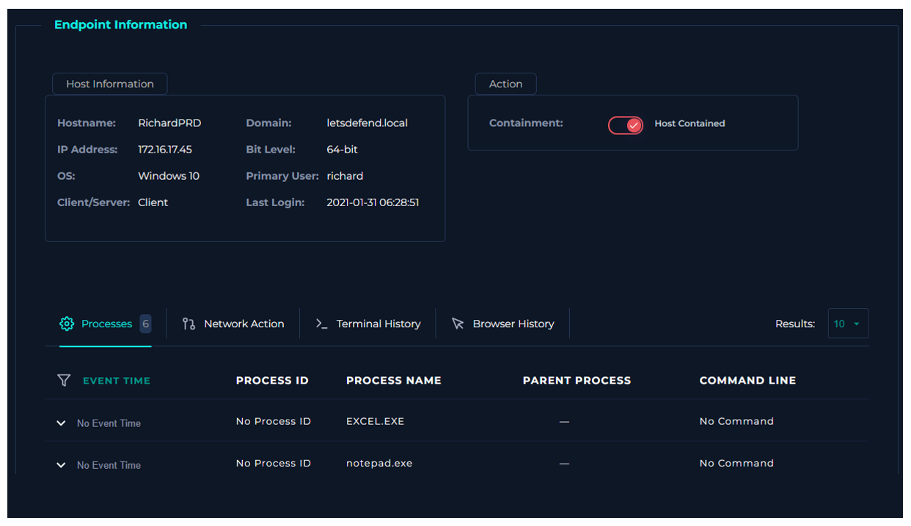

  

---

# Analizar correo electrónico

Antes de comenzar el análisis, se debe obtener información sobre el correo electrónico entrante.

### ¿Cuándo se envió?

**Respuesta:** `2021-01-31 07:48:30`

### ¿Cuál es la dirección SMTP del correo electrónico?

**Respuesta:** `49.234.43.39`

### ¿Cuál es la dirección del remitente?

**Respuesta:** `accounting@cmail.carleton.ca`

### ¿Cuál es la dirección del destinatario?

**Respuesta:** `richard@letsdefend.io`

### ¿Es sospechoso el contenido del correo?

**Respuesta:** `Es la supuesta factura de una compra.`

### ¿Hay archivos adjuntos o URLs en el correo electrónico?

**Respuesta:** `Si, un archivo de excel.`

---

# Analizar URL/Archivo adjunto

Según VirusTotal estamos ante un archivo malicioso.

# Verificar si el correo fue entregado al usuario

El correo si fue entregado al usuario.

# Verificar si alguien abrió el archivo/URL malicioso

Buscando una conexión con la IP 5.135.143.133, encontramos un dispositivo que si tuvo conexión.

Debemos contener este host.

**VEREDICTO:** `VERDADERO POSITIVO`
