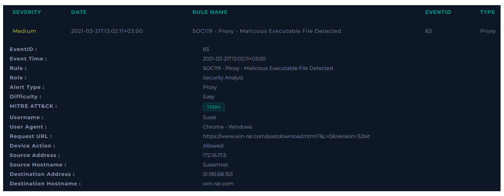
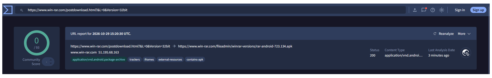
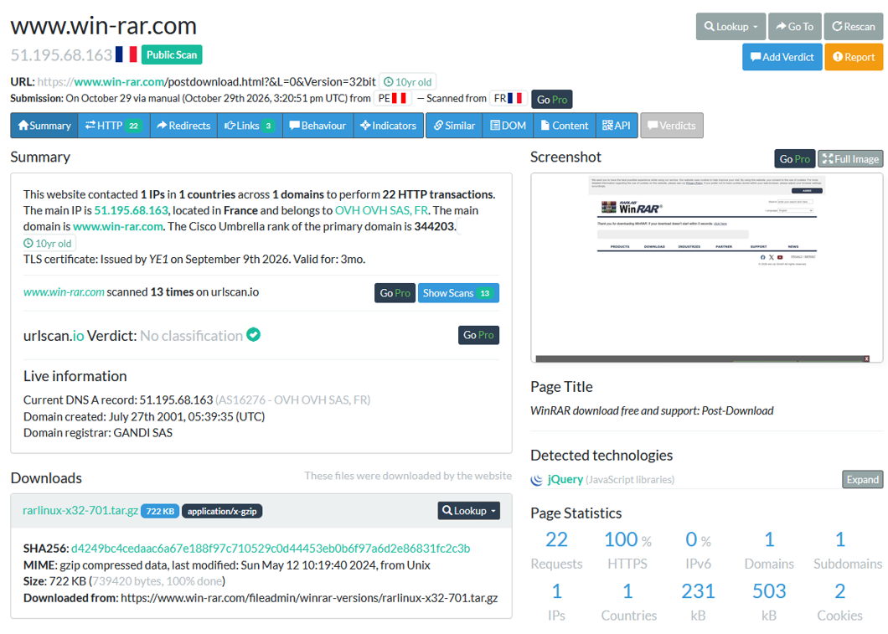

  

---

# Recopilación de datos

**Dirección de origen:** 172.16.17.5

**Dirección de destino:** 51.195.68.163

**User-Agent:** Chrome – Windows

# Análisis de la URL

Ni VirusTotal ni urlscan.io detectan que sea una URL maligna.

**VEREDICTO:** `FALSO POSITIVO`
