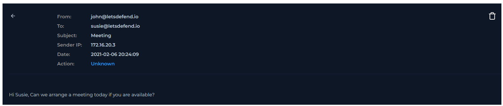

  

---

# Analizar correo electrónico

Antes de comenzar el análisis, se debe obtener información sobre el correo electrónico entrante.

### ¿Cuándo se envió?

**Respuesta:** `2021-02-06 20:24:09`

### ¿Cuál es la dirección SMTP del correo electrónico?

**Respuesta:** `172.16.20.3`

### ¿Cuál es la dirección del remitente?

**Respuesta:** `john@letsdefend.io`

### ¿Cuál es la dirección del destinatario?

**Respuesta:** `susie@letsdefend.io`

### ¿Es sospechoso el contenido del correo?

**Respuesta:** `No, si vemos el dominio del correo, ambos tienen el de la misma empresa y solo es un mensaje para una reunión virtual.`

### ¿Hay archivos adjuntos o URLs en el correo electrónico?

**Respuesta:** `No`

**VEREDICTO:** `FALSO POSITIVO`
