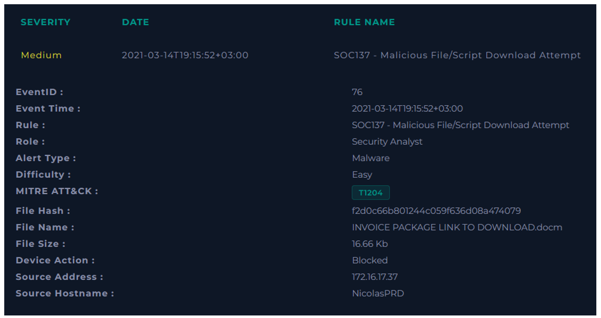
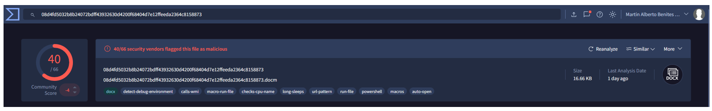
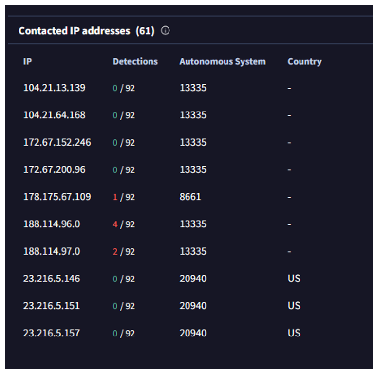

  

---

**File Hash:** `f2d0c66b801244c059f636d08a474079`

**Source Address:** `172.16.17.37`

**Source Hostname:** `NicolasPRD`

### Verificar si el malware está en cuarentena/limpiado

*	Log Management
*	Endpoint Security

**¿Malware en cuarentena/limpiado?** No hay rastros de este, así que consideramos que esta en cuarentena.

Según VT es un archivo malicioso.

No se accedió a ninguno de las IPs relacionadas.

**VEREDICTO:** `VERDADERO POSITIVO`
