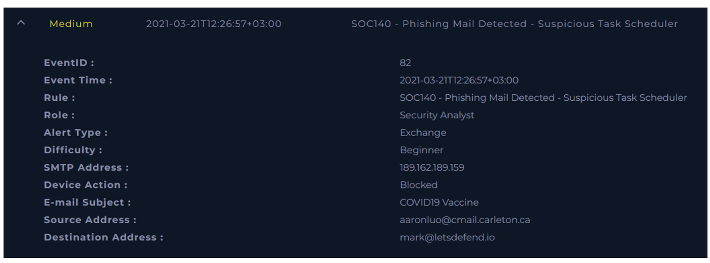
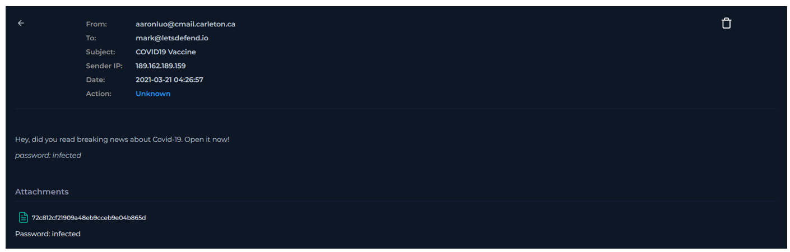
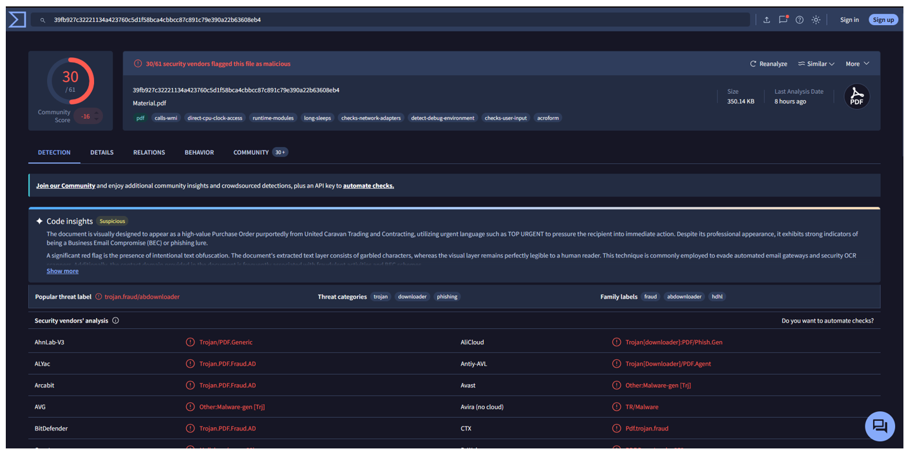

  

---

# Analizar correo electrónico

Antes de comenzar el análisis, se debe obtener información sobre el correo electrónico entrante.

### ¿Cuándo se envió?

**Respuesta:** `2021-03-21 04:26:57`

### ¿Cuál es la dirección SMTP del correo electrónico?

**Respuesta:** `189.162.189.159`

### ¿Cuál es la dirección del remitente?

**Respuesta:** `aaronluo@cmail.carleton.ca`

### ¿Cuál es la dirección del destinatario?

**Respuesta:** `mark@letsdefend.io`

### ¿Es sospechoso el contenido del correo?

**Respuesta:** `Si, se nos agrega un archivo adjunto en una supuesta información acerca de la vacuna del COVID19.`

### ¿Hay archivos adjuntos o URLs en el correo electrónico?

**Respuesta:** `Si. Un archivo PDF.`

# Analizar URL/Archivo adjunto

Puede utilizar los productos/servicios gratuitos a continuación.

* AnyRun
* VirusTotal
* URLHouse
* URLScan
* HybridAnalysis

Según VirusTotal estamos frente a un archivo malicioso.

### ¿Verificar si el correo fue entregado al usuario?

**Respuesta:** `Fue bloqueado.`

**VEREDICTO:** `TRUE POSITIVE`
