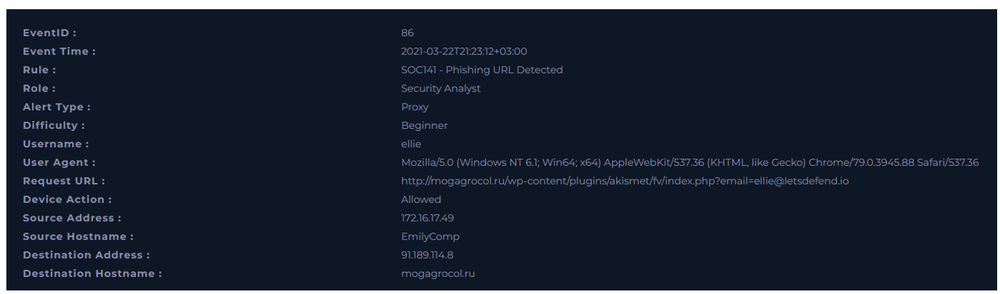
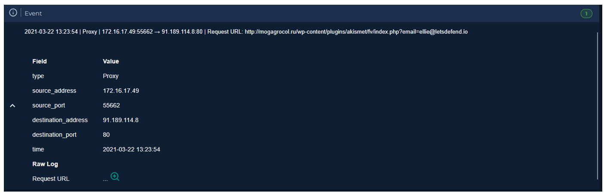
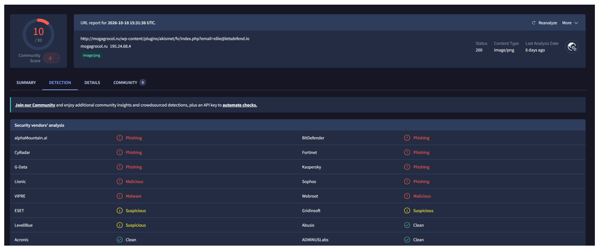

  

---

# Recopilar datos

**Dirección de origen:** `172.16.17.49`

**Dirección de destino:** `91.189.114.8`

**User-Agent:** `Mozilla/5.0 (Windows NT 6.1; Win64; x64) AppleWebKit/537.36 (KHTML, like Gecko) Chrome/79.0.3945.88 Safari/537.36`

# Buscar registro

Buscamos en el Log Management.

**Request URL:** `http://mogagrocol.ru/wp-content/plugins/akismet/fv/index.php?email=ellie@letsdefend.io`

# Analizar dirección URL

Puede utilizar los productos/servicios gratuitos a continuación.

* AnyRun
* VirusTotal
* URLHouse
* URLScan
* HybridAnalysis

Es una URL maliciosa según VirusTotal.

# ¿Alguien ha accedido a la IP/URL/Dominio?

Si, la IP 172.16.17.49.

**VEREDICTO:** `TRUE POSITIVE`
