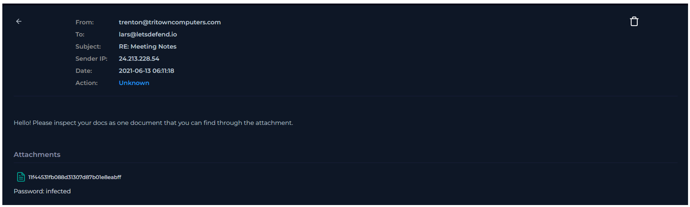
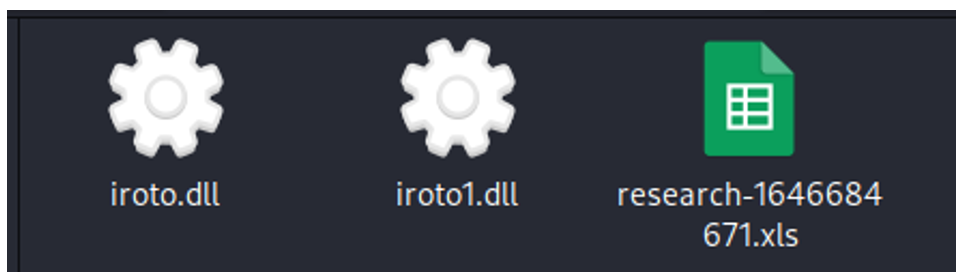
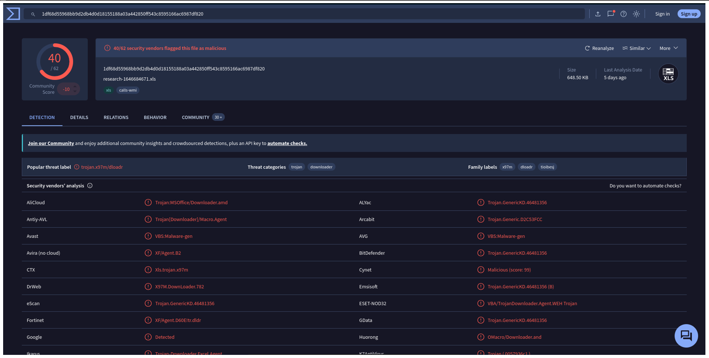
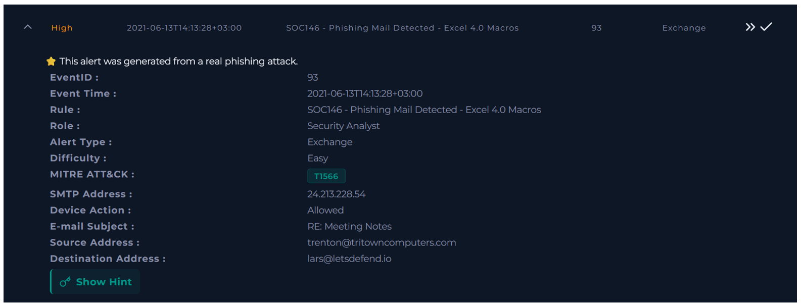
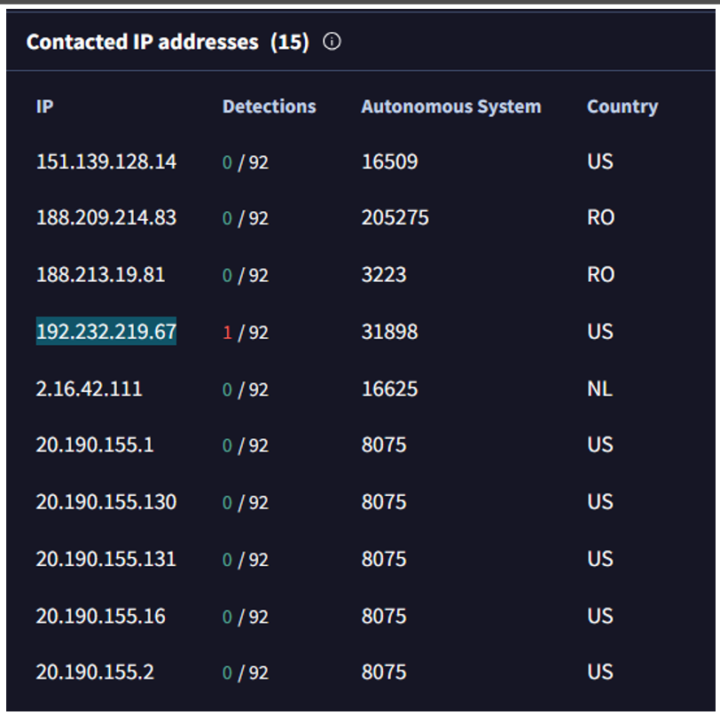
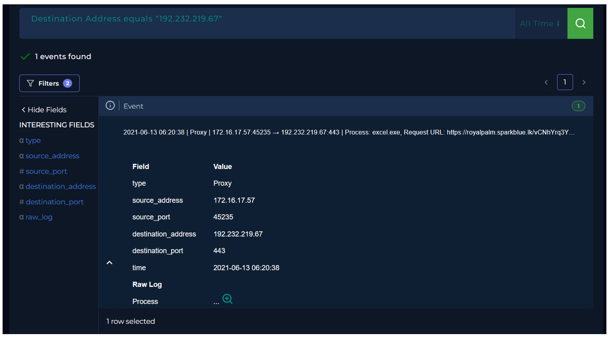
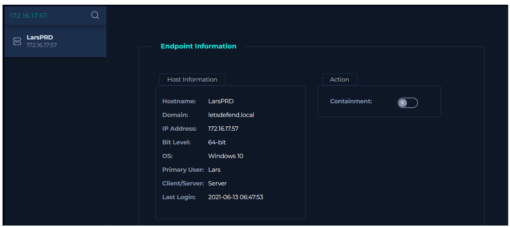
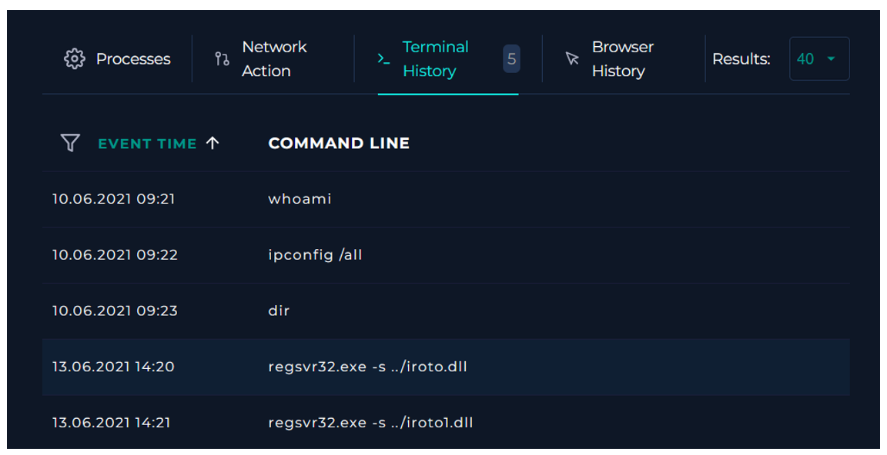

  

---

# Analizar correo electrónico

Antes de comenzar el análisis, se debe obtener información sobre el correo electrónico entrante.

### ¿Cuándo se envió?

**Respuesta:** `2021-06-13 06:11:18`

### ¿Cuál es la dirección SMTP del correo electrónico?

**Respuesta:** `24.213.228.54`

### ¿Cuál es la dirección del remitente?

**Respuesta:** `trenton@tritowncomputers.com`

### ¿Cuál es la dirección del destinatario?

**Respuesta:** `lars@letsdefend.io`

### ¿Es sospechoso el contenido del correo?

**Respuesta:** `Sí. El mensaje solicita revisar documentos adjuntos y utiliza un archivo protegido con contraseña (infected).`

### ¿Hay algún archivo adjunto?

**Respuesta:** `Sí. Hay un archivo adjunto llamado ff44531fb088d31307d87b01e8eabff. La contraseña indicada es infected.`

---

# Analizar URL/Archivo adjunto

Analizar URL/Archivo adjunto en sandboxes de terceros. Puede utilizar los productos/servicios gratuitos a continuación.

*	AnyRun
*	VirusTotal
*	URLHouse
*	URLScan
*	HybridAnalysis

Este archivo es malicioso según VirusTotal.

---

# Verificar si el correo fue entregado al usuario

Según vemos en la descripción de la alerta, el correo fue entregado.

---

# ¡Eliminar correo electrónico del destinatario!

Debe eliminar el correo electrónico malicioso del buzón del usuario.

---

# Verificar si alguien abrió el archivo/URL malicioso

Buscamos las IPs contactadas por este archivo malicioso en VirusTotal. Encontramos una IP detectada.

Buscamos esa IP y vemos que esta fue contactada por un endpoint de nuestra empresa.

Esta IP le pertenece a LarsPRD.

Podemos deducir que este correo fue abierto.

---

# Conclusión

Como resultado del análisis del sandbox del archivo de Excel adjunto al correo electrónico, se observa que es dañino. En el análisis del sandbox, se obtienen direcciones c2. Cuando se buscan las direcciones c2 a través de la gestión de registros, se observa que hay acceso, por lo tanto, se entiende que el archivo de Excel malicioso se ejecuta. Cuando se determina la dirección de origen en Log Management y se busca en Endpoint Management, se observa que es un dispositivo LarsPRD. Cuando se examinan el Historial del Navegador y las Conexiones de Red del dispositivo LarsPRD, se ha aclarado que el dispositivo LarsPRD se comunica con direcciones maliciosas. Cuando se examina el Historial de CMD de LarsPRD, se observa que se ejecuta el comando regsvr32, que está incluido en las macros de Excel 4.0.

**VEREDICTO:** `TRUE POSITIVE`
