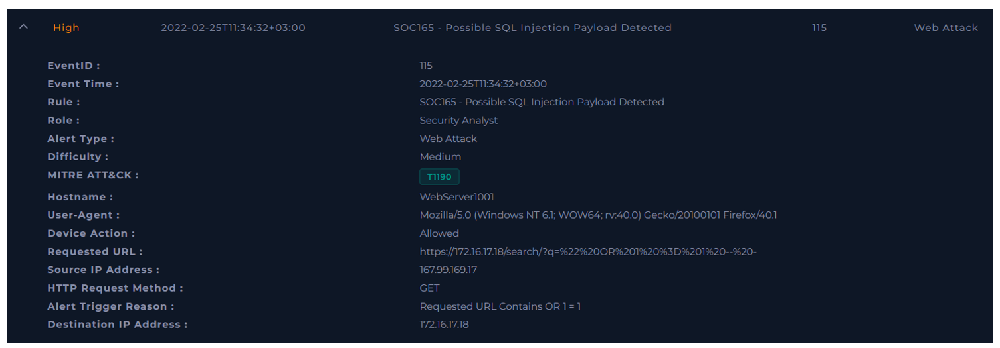
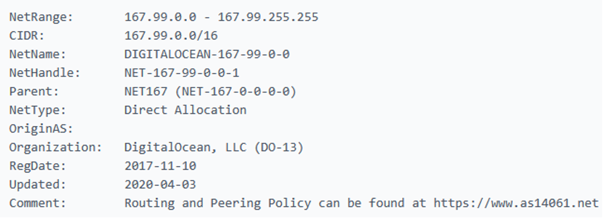
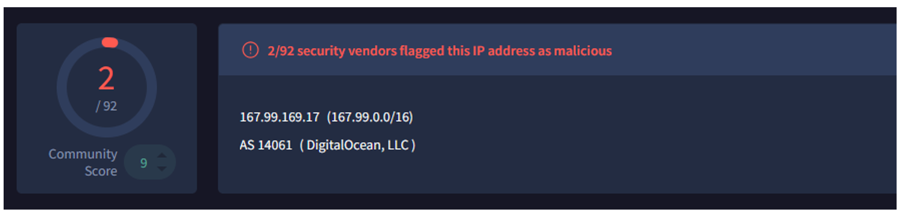
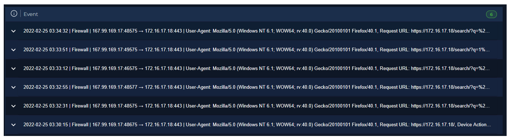
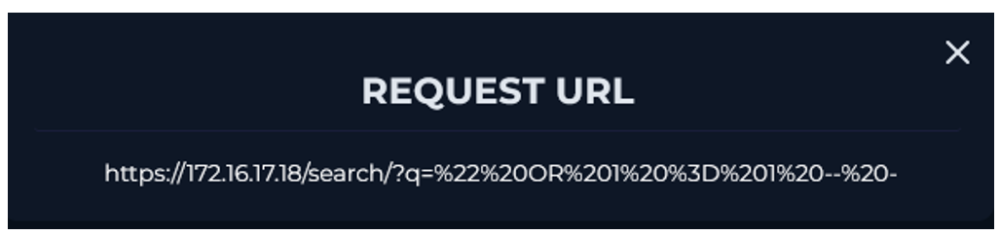
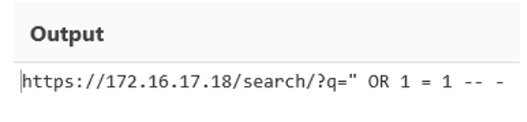
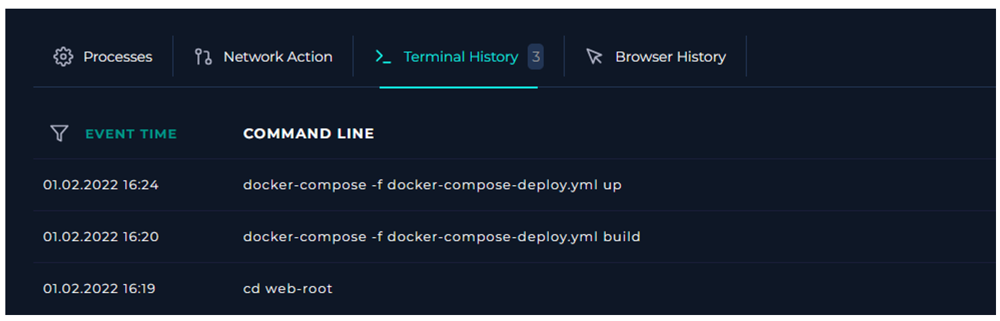

  

---

# Recopilar datos

Reúna algo de información que pueda obtenerse rápidamente para comprender mejor el tráfico. Esto puede resumirse de la siguiente manera.

Propiedad de las direcciones IP y los dispositivos.

**Si el tráfico proviene de fuera (Internet):** Si, proviene de una IP pública.

**Propiedad de la dirección IP:** La dirección pertenece a un bloque de IP asignado directamente a DigitalOcean, LLC, empresa que proporciona servidores virtuales, infraestructura en la nube y otros servicios de alojamiento. Fuente: who.is

Es importante distinguir entre el propietario del bloque de direcciones y el usuario de la IP: DigitalOcean administra el rango, pero la dirección concreta puede estar asignada a un cliente que ejecuta un servidor o una aplicación.

**Reputación de la dirección IP:** 2 motores de VirusTotal lo catalogan como IP maliciosa y 2 como sospechosa.

# Examinar el tráfico HTTP

Verifique el contenido del tráfico en busca de cualquier condición sospechosa, como payloads de ataques web (Inyección SQL, XSS, Inyección de Comandos, IDOR, RFI/LFI).

Encontramos 6 registros de esta interacción:

Examine todos los campos en la Solicitud HTTP. Dado que los atacantes no solo atacan a través de la URL, todos los datos de la fuente deben ser examinados para comprender si realmente existe un ciberataque.

Analizamos el primer registro:

Usando la herramienta CyberChef decodificamos esta URL:

Vemos que se trata de un payload muy conocido de inyección SQL.

No fue una prueba de pentesting planeada. Fue un ataque de internet a la red de la compañía.

Tampoco se ejecutaron comandos maliciosos.

# ¿Necesita escalado a Nivel 2?

**La escalación a Nivel 2 debe realizarse en las siguientes situaciones:**

* En casos donde el ataque tenga éxito.
*	Cuando el atacante compromete un dispositivo en la red interna (en casos donde la dirección del tráfico dañino es de dentro → dentro).

**La escalación a Nivel 2 no es necesaria en los siguientes casos:**

* En casos donde los ataques desde Internet no tengan éxito

*Nota: Las instituciones pueden tener su propio procedimiento de escalación. No olvide aprender sobre el procedimiento de escalación en su institución.*

En nuestro caso no se necesita porque el ataque no tuvo éxito.

**VEREDICTO:** `VERDADERO POSITIVO`
