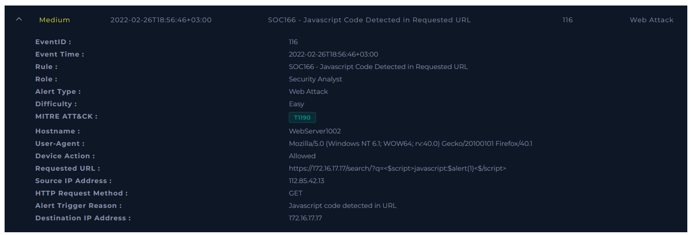
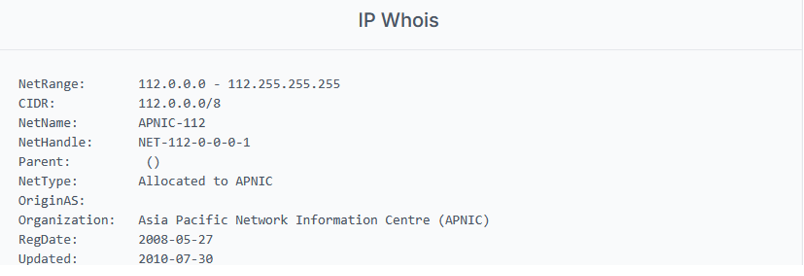
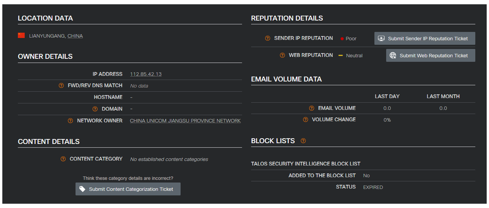
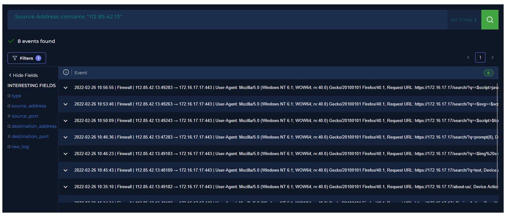
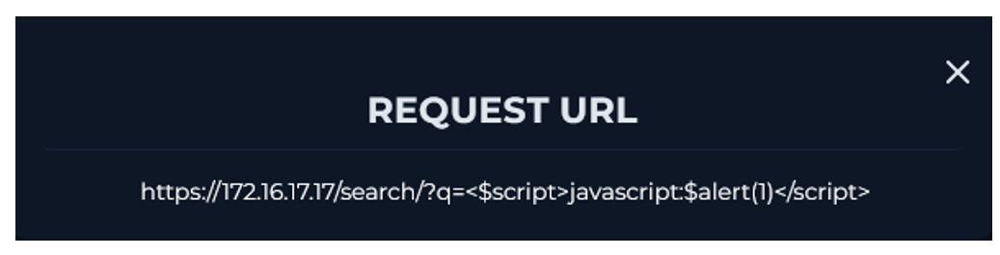
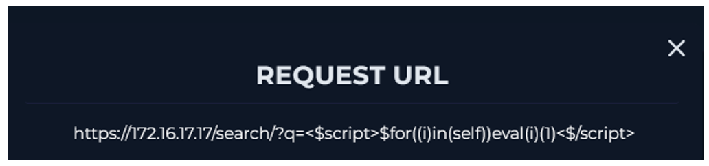
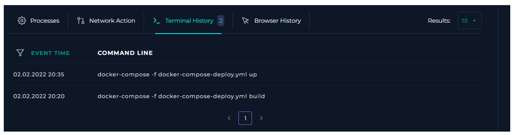

  

---

# Recopilar datos

Reúna algo de información que pueda obtenerse rápidamente para comprender mejor el tráfico. Esto puede resumirse de la siguiente manera.

El tráfico proviene de una IP pública, así que viene de afuera.

**Propiedad de la dirección IP:** El registro indica Asia Pacific Network Information Centre (APNIC), una organización que administra y distribuye recursos de direcciones IP en la región de Asia-Pacífico.

**Reputación de la dirección IP:** Según Cisco Talos esta IP tiene una reputación mala.

# Examinar el tráfico HTTP

Verifique el contenido del tráfico en busca de cualquier condición sospechosa, como payloads de ataques web (Inyección SQL, XSS, Inyección de Comandos, IDOR, RFI/LFI). Encontramos 8 registros.

Examine todos los campos en la Solicitud HTTP. Dado que los atacantes no solo atacan a través de la URL, todos los datos de la fuente deben ser examinados para comprender si realmente existe un ciberataque.

Encontramos payloads de javascript incrustados.

En la búsqueda de emails de pruebas de penetración agendadas, no se encontró nada relacionado al objetivo analizado.

Tampoco se encontró el uso de comandos maliciosos.

No es necesario escalar el caso al SOC level 2.

**VEREDICTO:** `VERDADERO POSITIVO`
