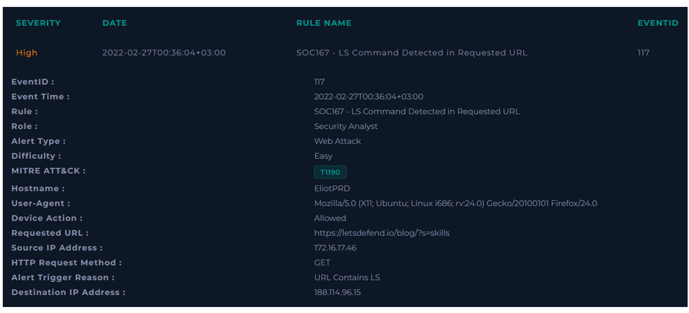
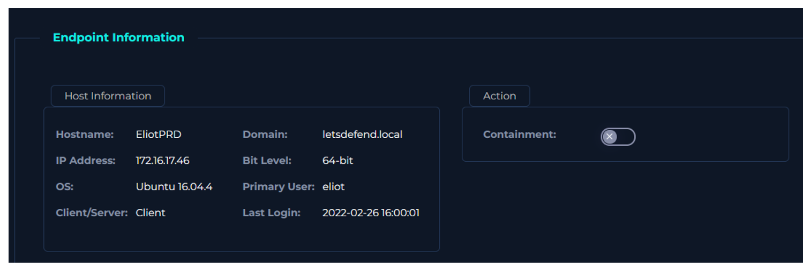
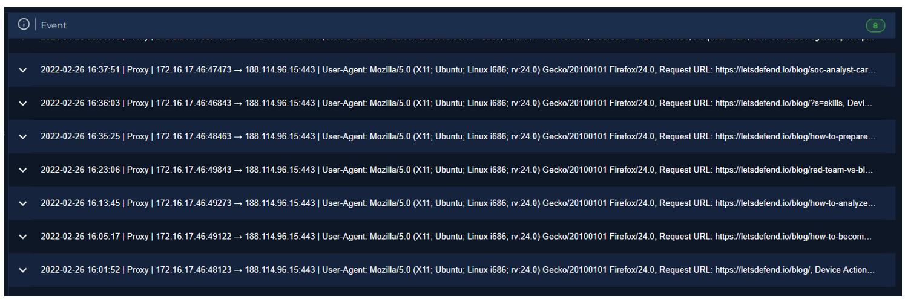
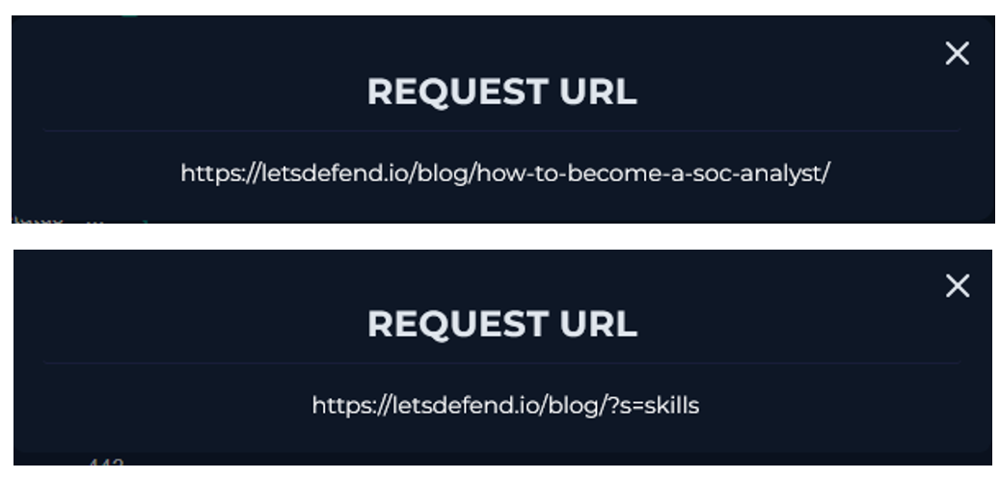

  

---

# Recopilar datos

Reúna algo de información que pueda obtenerse rápidamente para comprender mejor el tráfico. Esto puede resumirse de la siguiente manera.

El tráfico proviene de la red de la empresa.

**Nombre del host del dispositivo:** `EliotPRD`

**Quién es el propietario del dispositivo (nombre de usuario):** `eliot`

**Hora del último inicio de sesión del usuario:** `2022-02-26 16:00:01`

En el Log Management encontramos 7 registros que tienen que ver con la interacción que estamos analizando.

Encontramos búsquedas normales.

# Conclusión
Cuando se examina la URL de la Solicitud, se ve que la palabra "skills" se busca en la página del Blog de LetsDefend. Sin embargo, las letras "ls" al final de la palabra hicieron que la regla se activara incorrectamente. 
Es una alarma de falso positivo. Para estar seguro, cuando se examina el Historial del Navegador del dispositivo desde la página de Endpoint Security, se confirma que no hay ataque.

**VEREDICTO:** `FALSO POSITIVO`
