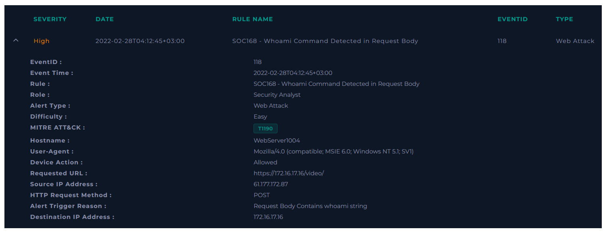
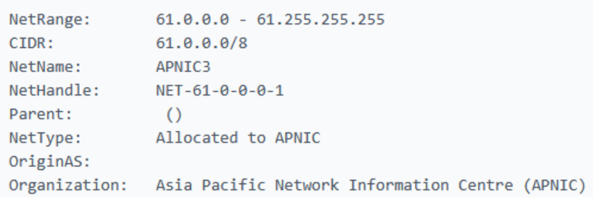
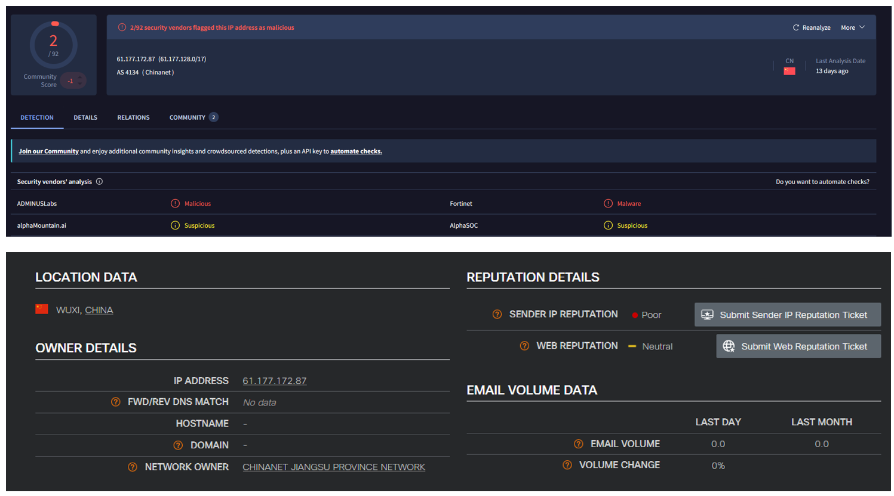
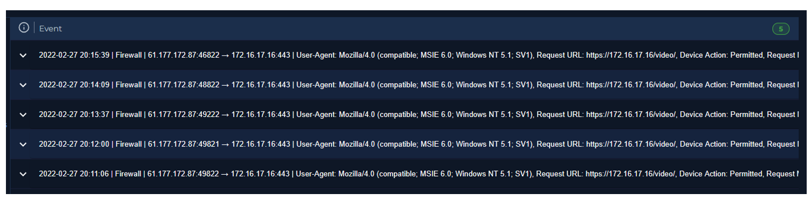
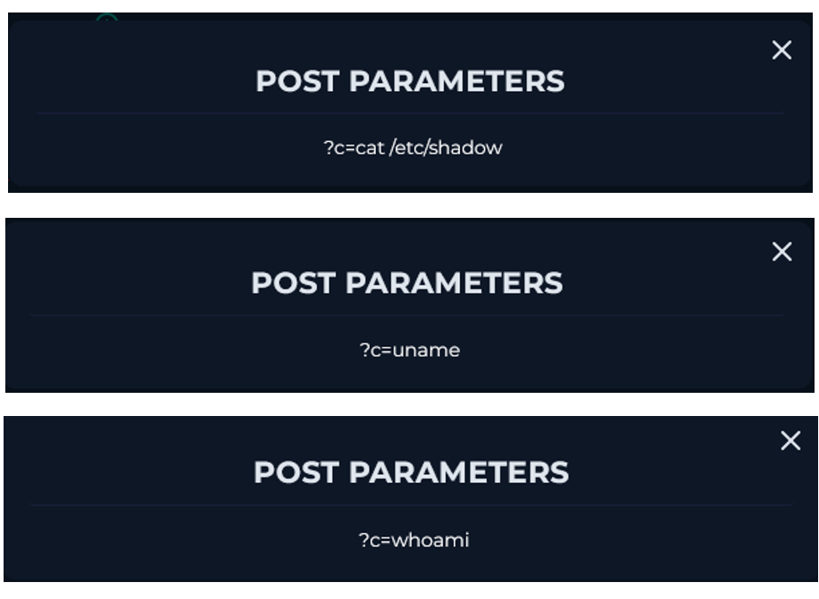
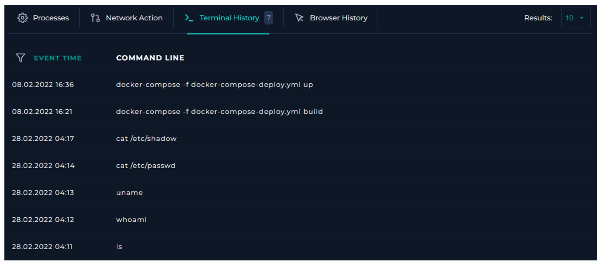
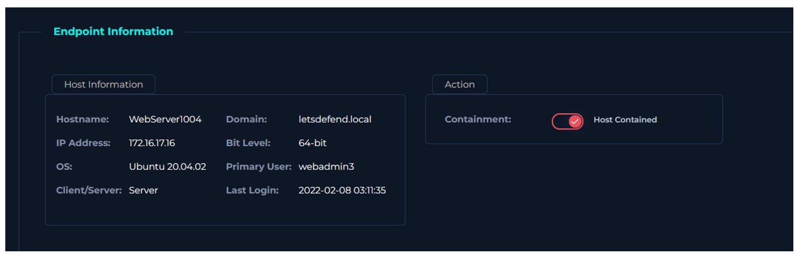

  

---

# Recopilar datos

Reúna algo de información que pueda obtenerse rápidamente para comprender mejor el tráfico. Esto puede resumirse de la siguiente manera.

**Propiedad de las direcciones IP y los dispositivos:** El registro indica Asia Pacific Network Information Centre (APNIC), una organización que administra y distribuye recursos de direcciones IP en la región de Asia-Pacífico.

El tráfico proviene de fuera (Internet).

**Reputación de la dirección IP:** Tanto Cisco Talos como VitusTotal lo catalogan como malicioso.

Encontramos un total de 5 registros donde esta IP está involucrada.

Encontramos en los siguientes parámetros comandos maliciosos.

Estamos ante tráfico malicioso.

**Tipo de ataque:** Command Injection

No hay registro de que haya sido planeado alguna prueba de penetración.

Vemos que los comandos que fueron solicitados si fueron ejecutados por el servidor. El ataque fue exitoso.

# Contención

Dado que se detecta que el dispositivo está comprometido, el dispositivo debe ser aislado para restringir al atacante, prevenir la propagación del ataque y reducir el impacto.

# ¿Necesita escalado a Nivel 2?

El escalado a Nivel 2 debe realizarse en las siguientes situaciones.

*	En casos donde el ataque tenga éxito
*	Cuando el atacante compromete un dispositivo en la red interna (en casos donde la dirección del tráfico dañino es de dentro → dentro)

El escalado a Nivel 2 no es necesario en los siguientes casos.

*	En casos donde los ataques desde Internet no tengan éxito

*Nota: Las instituciones pueden tener su propio procedimiento de escalado. No olvide aprender sobre el procedimiento de escalado en su institución.*

En nuestro caso debemos realizar escalado.

**VEREDICTO:** `VERDADERO POSITIVO`

# Conclusión

Dado que la razón para activar la alerta es la palabra "whoami" en el Request Body, primero debemos determinar si se activó correctamente. 
Ingresamos a la página de Log Management y filtramos por la dirección IP de origen desde el campo de búsqueda y llegamos a la solicitud relevante. 
Cuando se examina el Request Body, se ve que el atacante realmente envió el comando whoami. Cuando se examinan otras solicitudes, vemos que el atacante está ejecutando más de un comando. 
Podemos entender si el ataque fue exitoso observando el Historial de Comandos del dispositivo llamado WebServer1004 en la página de Endpoint Security. 
El Historial de Comandos muestra todos los comandos ejecutados por el atacante. Esto indica que los comandos se ejecutaron exitosamente. 
El dispositivo debe ser contenido. Es una alerta de Verdadero Positivo.
