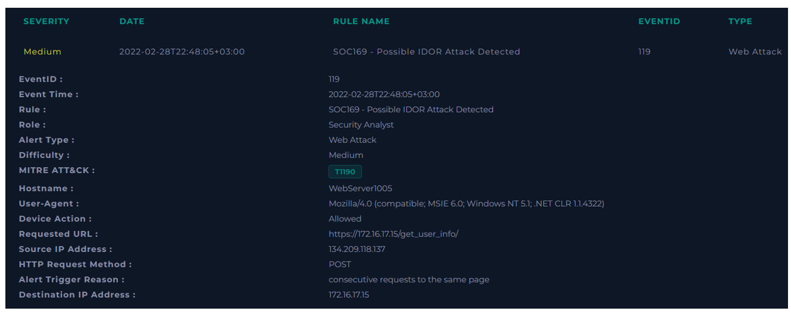
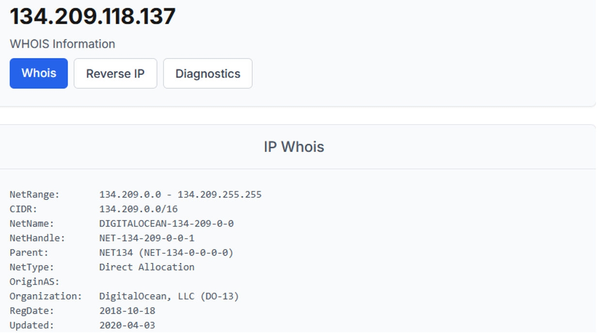
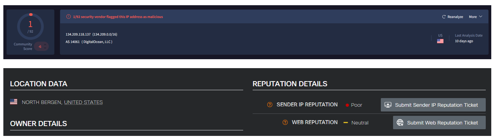
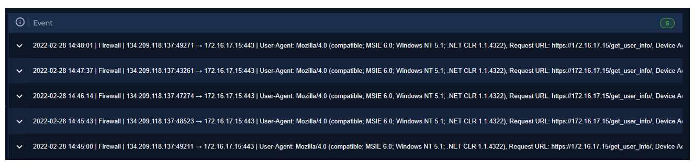
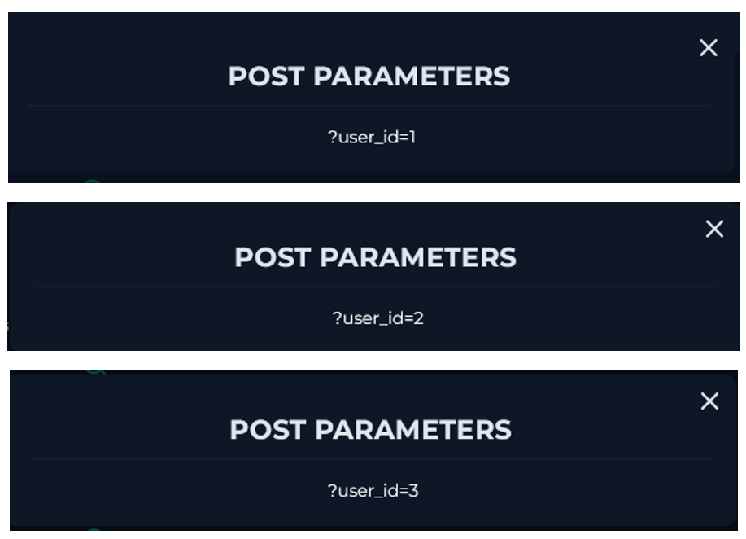
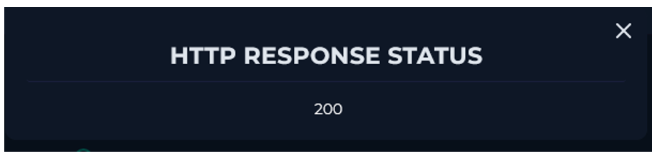
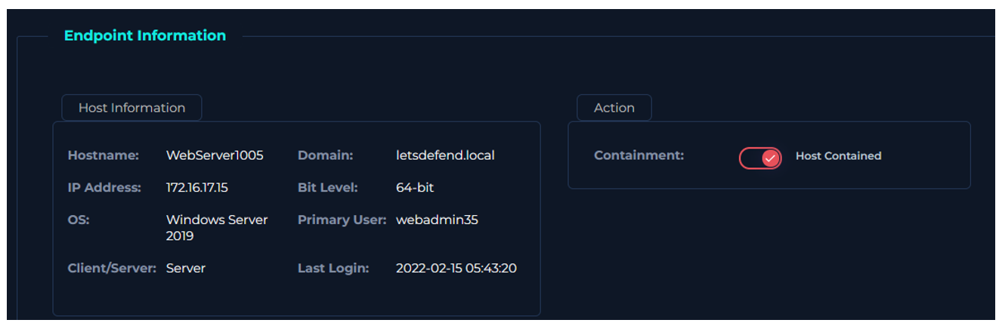

  

---

# Recopilar datos

Reúna algo de información que pueda obtenerse rápidamente para comprender mejor el tráfico. Esto puede resumirse de la siguiente manera.

**Propiedad de las direcciones IP y los dispositivos:** La dirección pertenece a un bloque de IP asignado directamente a DigitalOcean, LLC, empresa que proporciona servidores virtuales, infraestructura en la nube y otros servicios de alojamiento.

El tráfico proviene de fuera (Internet).

**Reputación de la dirección IP:** Tanto VirusTotal como CiscoTalos nos dan malas referencias de esta IP.

En el Log Management encontramos 5 registros relacionados a esta IP.

Analizando cada log en los parámetros POST, encontramos que efectivamente hubo un ataque IDOR. Hay cambios en el id del 1 al 5.

No hay ningún registro de pruebas de penetración para este caso.

Analizando cada log, vemos que todas dieron una respuesta de código 200, por lo que todas estas solicitudes fueron procesadas correctamente. El ataque fue todo un éxito y se debe escalar a SOC nivel 2.

Finalmente contenemos el host.

**VEREDICTO:** `VERDADERO POSITIVO`

# Conclusión
En la página de Log Management, filtramos por dirección IP de origen y detectamos todas las solicitudes.
Cuando se examinaron las solicitudes, se determinó que el atacante quería cambiar el valor del ID y acceder a información perteneciente a diferentes usuarios. 
Cuando se examinan los tamaños de las solicitudes, hay un tamaño de respuesta diferente para cada usuario y el código de estado es 200. Por esta razón, se considera que el ataque ha sido exitoso. 
Dado que el ataque puede haber sido exitoso, el dispositivo debe ser contenido y escalado a Nivel 2.
