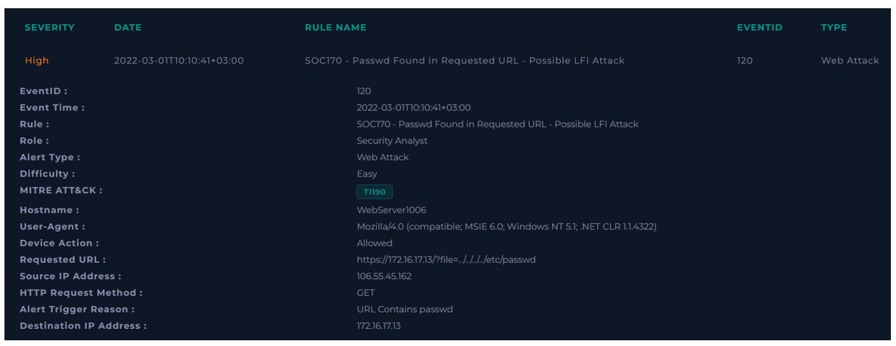
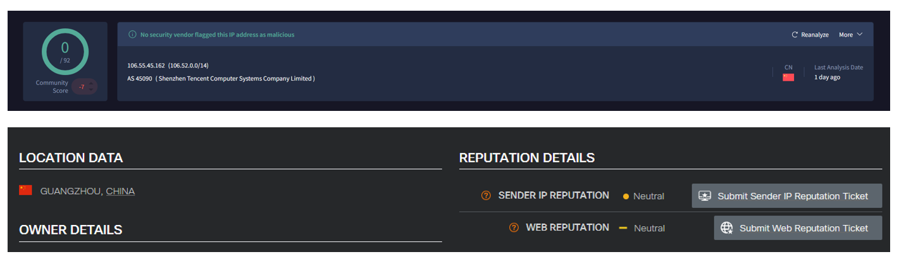
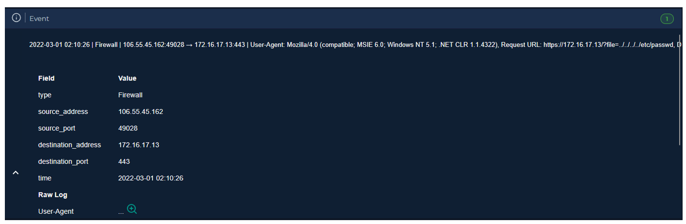

  

---

# Recopilar datos

Reúna algo de información que pueda obtenerse rápidamente para comprender mejor el tráfico. Esto puede resumirse de la siguiente manera.

El tráfico proviene de fuera (Internet).

**Reputación de la dirección IP:** Según Cisco Talos y Virustotal, la IP es neutral.

Buscando información en el Log Management, encontramos un solo registro relacionado a esta IP.

Analizando la URL solicitada, encontramos que intento inyectar un payload en el parámetro file.

No hay registros que indiquen que hubo pruebas de penetración contra este servidor.

Si vemos la respuesta, podemos observar que hubo un error de servidor, el ataque no fue exitoso. No hay necesidad de escalar al SOC nivel 2.

**VEREDICTO:** `VERDADERO POSITIVO`

# Conclusión

Desde la página de Log Management, se debe realizar el filtrado según la dirección IP de origen y se debe llegar a la solicitud relevante. 
Cuando examinamos los detalles de la solicitud, se ve que el código de estado es 500 y el tamaño de la respuesta es 0. Por esta razón, el ataque no tuvo éxito. No hay necesidad de contener el dispositivo ni escalar el incidente al siguiente nivel.
