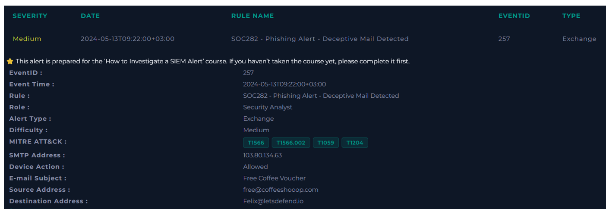
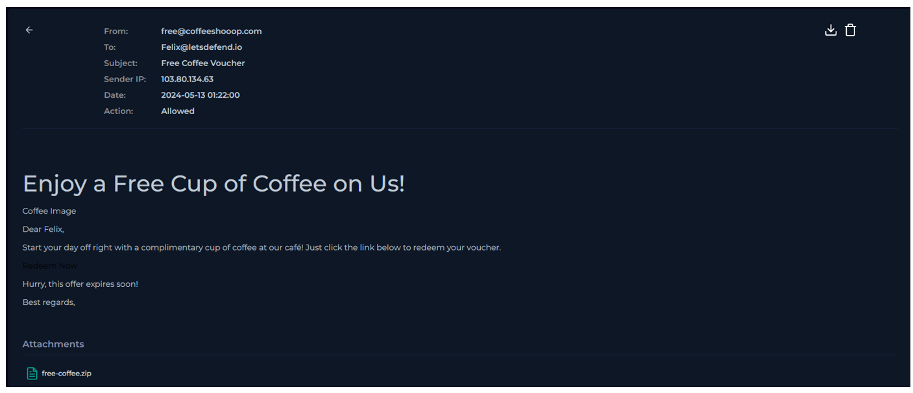
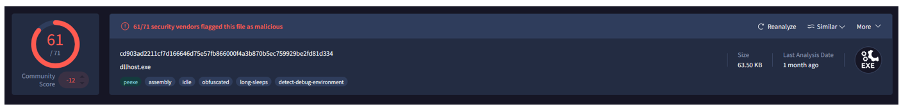
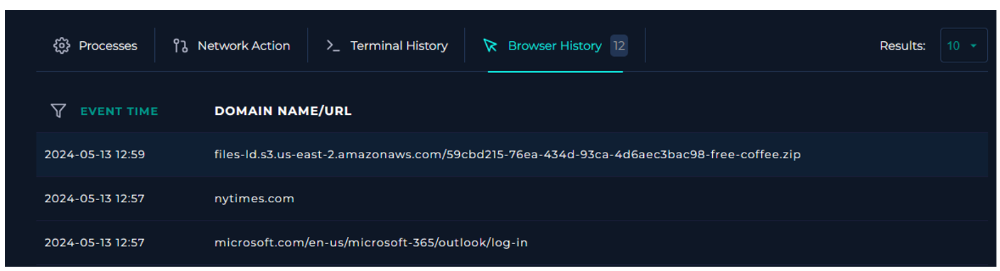

  

---

# Analizar correo electrónico

Antes de comenzar el análisis, se debe obtener información sobre el correo electrónico entrante.

### ¿Cuándo se envió?

**Respuesta:** `2024-05-13 01:22:00`

### ¿Cuál es la dirección SMTP del correo electrónico?

**Respuesta:** `103.80.134.63`

### ¿Cuál es la dirección del remitente?

**Respuesta:** `free@coffeeshooop.com`

### ¿Cuál es la dirección del destinatario?

**Respuesta:** `Felix@letsdefend.io`

### ¿Es sospechoso el contenido del correo?

**Respuesta:** `Si, tiene archivos adjuntos.`

### ¿Hay algún archivo adjunto?

**Respuesta:** `Si. Un archivo ejecutable.`

# Análisis del archivo

Analizamos el archivo ejecutable en VirusTotal.

El archivo es un malware.

Buscando el host de Félix, vemos que su IP es: 172.16.20.151

Vemos que también ejecutó el archivo descargado.

Correlacionando los tiempos, tuvo interacción con la IP: 37.120.233.226

Finalmente ponemos en cuarentena al host de Felix.

**VEREDICTO:** `VERDADERO POSITIVO`
