

  

---

# Escenario del Sherlock

El equipo de SOC de tu organización interceptó un binario sospechoso durante una operación rutinaria de caza de amenazas en un servidor Linux. 
El archivo fue encontrado en /var/tmp con un nombre inusual y estaba intentando establecer conexiones salientes. El análisis inicial sugiere que podría ser un agente de post-explotación. 
Tu tarea es realizar un análisis estático del binario para identificar sus capacidades, extraer indicadores de compromiso y comprender la infraestructura del actor de amenazas.

---

# Preguntas

## Tarea 01

**¿Cuál es el hash SHA256 del binario malicioso?**

Se nos entrega una carpeta que contiene un archivo ejecutable llamado "agent".

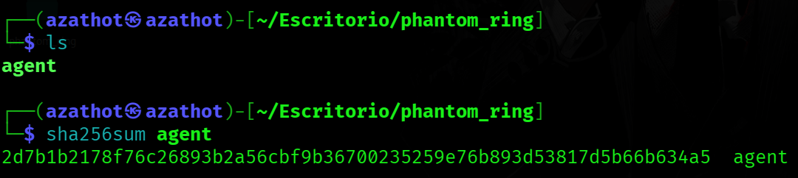

**Respuesta:** `2d7b1b2178f76c26893b2a56cbf9b36700235259e76b893d53817d5b66b634a5`

## Tarea 02

**¿Cuál es la dirección IP hardcodeada en el binario para la comunicación C2?**

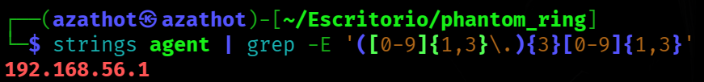

**Respuesta:** `192.168.56.1`

## Tarea 03

**¿A qué puerto se conecta el agente en el servidor C2?**

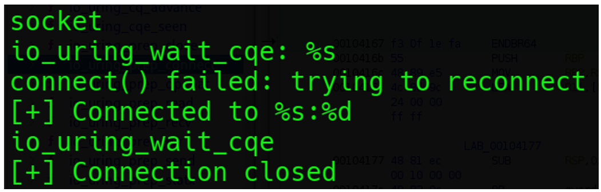

El puerto está siendo llamado como variable, lo mejor será usar Ghidra para descompilar el programa y ver el valor de la variable.

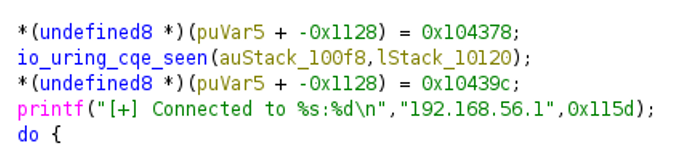

El valor del puerto está en hexadecimal (0x115d) que es el puerto 4445 en decimal.

**Respuesta:** `4445`

## Tarea 04

**¿Cuántos segundos espera el agente antes de intentar reconectarse tras una conexión fallida?**

Para esto buscamos la función sleep. El valor de 0x78 en decimal es 120.

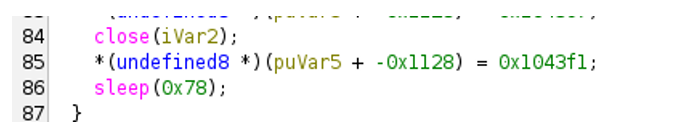

**Respuesta:** `120`

## Tarea 05

**¿Cuántos comandos diferentes soporta el agente? (excluyendo comandos inválidos)**

Eso lo encontramos en la función process_cmd, ahí vemos diferentes comandos comparados con la función strncmp, la cantidad de estas funciones strncmp llamadas es la respuesta.

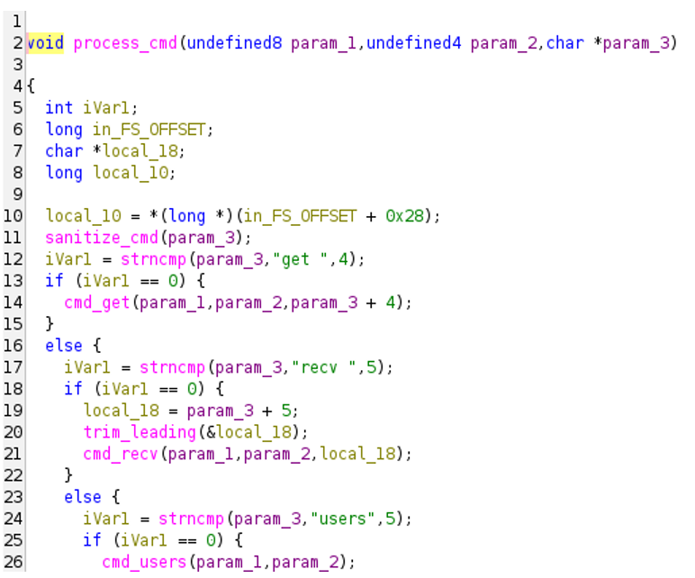

**Respuesta:** `11`

## Tarea 06

**¿Qué interfaz del kernel de Linux abusa este malware para evadir el monitoreo de syscalls del EDR?**

Todo el código gira en torno a io_uring_queue_init, io_uring_get_sqe, io_uring_prep_connect, io_uring_submit, etc. io_uring es una interfaz del kernel de Linux que permite operaciones asíncronas y ha sido utilizada por malware para evadir EDRs.

**Respuesta:** `io_uring`

## Tarea 07

**¿Qué archivo lee el agente para enumerar los usuarios conectados?**

El archivo /var/run/utmp es un archivo del sistema en sistemas operativos tipo Unix y Linux que registra en tiempo real quiénes tienen una sesión abierta en la computadora en ese preciso instante.

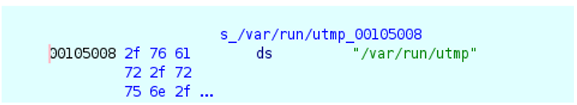

**Respuesta:** `/var/run/utmp`

## Tarea 08

**¿Qué directorio escanea el agente cuando busca binarios SUID para escalada de privilegios?**

Los binarios se encuentran en /usr/bin, vemos que si se tiene esta ruta referenciada.

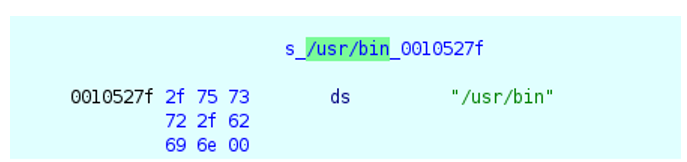

**Respuesta:** `/usr/bin`

## Tarea 09 

**¿Qué cadena busca el agente en /proc/[pid]/maps para identificar herramientas de seguridad que usan eBPF?**

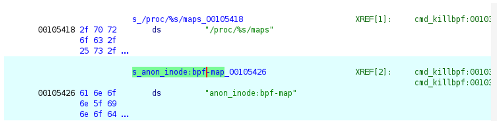

**Respuesta:** `anon_inode:bpf-map`

## Tarea 10

**¿Cuál es la ruta completa del primer archivo de tracing que el agente intenta deshabilitar?**

Buscamos la carpeta tracing. La primera fue la siguiente:

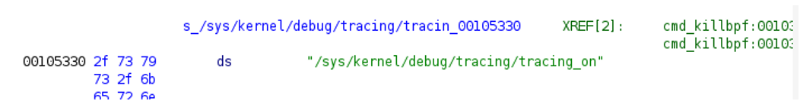

**Respuesta:** `/sys/kernel/debug/tracing/tracing_on`

## Tarea 11

**¿Qué ruta de procfs lee el agente para encontrar la ubicación de su propio ejecutable antes de la autodestrucción?**

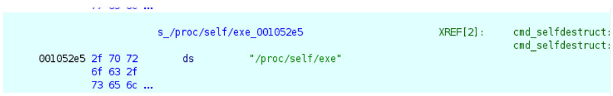

**Respuesta:** `/proc/self/exe`

## Tarea 12

**¿Qué cadena de comando compara el agente para activar la eliminación de su propio binario?**

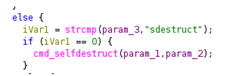

**Respuesta:** `sdestruct`
